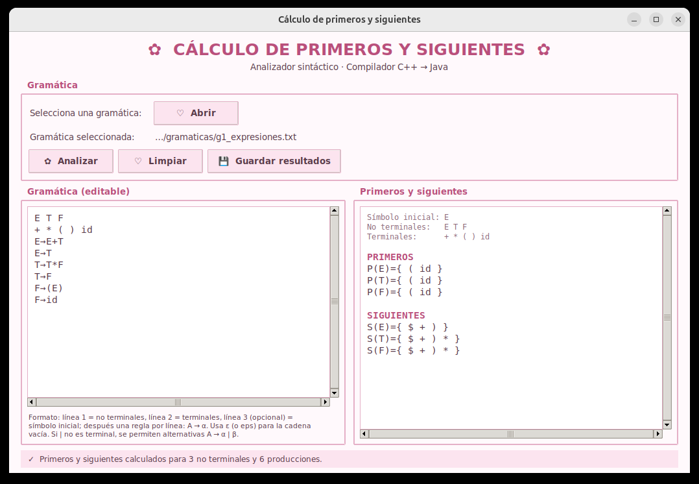
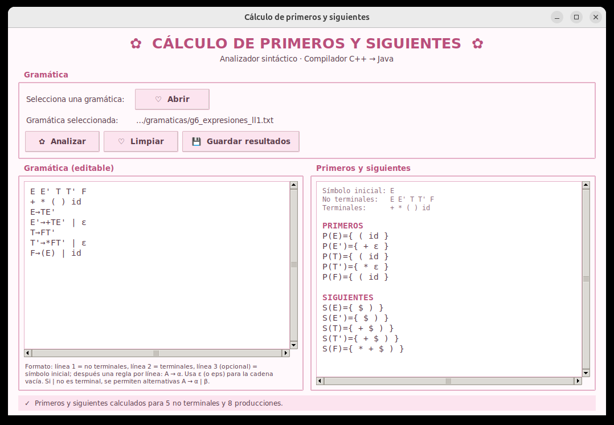

# Asignación 3 — Analizador sintáctico: Implementación del algoritmo Primeros y Siguientes

Primera entrega de la fase sintáctica del compilador **C++ → Java**: el cálculo
de los conjuntos **PRIMERO** y **SIGUIENTE** de los no terminales de una
gramática libre de contexto. Estos conjuntos se usan después para construir las
tablas del analizador sintáctico.

El programa lee una gramática desde un archivo de texto (o escrita en la propia
ventana) y muestra:

- **PRIMEROS**: `P(A)` para cada no terminal `A`.
- **SIGUIENTES**: `S(A)` para cada no terminal `A`.

Los resultados se pueden guardar en un archivo `.txt`. La interfaz es la misma
de la Asignación 2, organizada por capas, con el menú
*Analizadores → Analizador sintáctico → Algoritmo Primeros y Siguientes*
agregado. Los analizadores léxicos con AFD y con Flex siguen disponibles.



---

## Contenido de la carpeta

```
Analizador sintáctico Implementación del algoritmo primeros y siguientes/
├── gramaticas/              Gramáticas 1 a 6 de la asignación (.txt)
├── src/compi/               Código fuente, organizado por capas
│   ├── persistencia/                       Capa de persistencia (lógica)
│   │   ├── analizadorSintacticoLR/
│   │   │   ├── generales/gramatica.py               Gramatica y LectorGramatica: leen el archivo de la gramática
│   │   │   └── primerosYsiguientes/primeros_siguientes.py   PrimerosSiguientes: el algoritmo
│   │   └── analizadorLexico/               Analizadores léxicos de las Asignaciones 1 y 2
│   └── presentacion/                       Capa de presentación (interfaz)
│       ├── compilador.py                   Compilador: punto de entrada (main)
│       ├── ventana_principal.py            VentanaPrincipal: menús, logo y cambio de pantalla
│       ├── asintactico/
│       │   └── ventana_primeros_siguientes.py   Ventana del cálculo de primeros y siguientes
│       └── alexico/                        Pantallas del analizador léxico (AFD y Flex)
├── archivos_prueba/         Programas C++ de ejemplo para los analizadores léxicos
├── documentacion/           Documentos de la asignación
│   ├── informe_primeros_siguientes.pdf    Informe: algoritmos, implementación y pruebas
│   ├── asignacion_actividades.pdf         Reparto de actividades del equipo
│   └── bitacora_actividades.pdf           Bitácora de actividades
├── ejecutable/
│   └── PrimerosSiguientes.exe     Versión para Windows (no requiere instalar nada)
├── flex/                    lexer.l del analizador léxico en Flex (Asignación 2)
├── herramientas/            win_flex y TinyCC para Windows (ver LEEME.txt)
├── imagenes/                Logo de la UTM para la pantalla de inicio
├── capturas/                Imágenes de la interfaz usadas en este README
├── iniciar.bat              Lanzador para Windows
├── iniciar.sh               Lanzador para Linux y macOS
└── iniciar.command          Lanzador para macOS (doble clic)
```

---

## Cómo ejecutarlo

### Opción 1: ejecutable de Windows (sin instalar nada)

1. Descarga `ejecutable/PrimerosSiguientes.exe`.
2. Haz doble clic. La primera vez tarda unos segundos en abrir.
3. Si aparece **"Windows protegió su PC"**, presiona *Más información → Ejecutar
   de todas formas*. El aviso sale porque el programa no tiene firma digital.

Al abrir la ventana de Primeros y Siguientes, el `.exe` copia las gramáticas de
ejemplo a una carpeta `gramaticas/` junto al ejecutable.

### Opción 2: desde el código fuente (Windows, Linux y macOS)

Se necesita **Python 3.9 o superior con Tkinter**; no hay que instalar ninguna
biblioteca adicional. El cálculo de primeros y siguientes no necesita Flex; solo
el analizador léxico en Flex de la Asignación 2 pide `flex` y `gcc` en Linux y
macOS.

- **Windows / macOS:** el instalador de [python.org](https://www.python.org/downloads/)
  ya incluye Tkinter. En Windows marca *Add python.exe to PATH*.
- **Linux:** `sudo apt install python3 python3-tk` (Ubuntu/Debian) o
  `sudo dnf install python3 python3-tkinter` (Fedora).

| Sistema | Cómo abrirlo |
|---------|--------------|
| Windows | doble clic en `iniciar.bat` |
| macOS   | doble clic en `iniciar.command` (la primera vez: clic derecho → *Abrir*) |
| Linux   | `sh iniciar.sh` |

O directamente desde la carpeta `src`:

```bash
cd src
python3 -m compi.presentacion.compilador
```

---

## Cómo se usa

1. En el menú **Analizadores → Analizador sintáctico**, elige
   **Algoritmo Primeros y Siguientes**. Se abre una ventana hija de la ventana
   principal; mientras está abierta, la ventana principal no se puede usar.
2. Presiona **Abrir** y elige una gramática de `gramaticas/`, o escríbela en el
   panel de la izquierda.
3. Presiona **Analizar**. A la derecha aparecen el símbolo inicial, los no
   terminales, los terminales y los conjuntos PRIMEROS y SIGUIENTES.
4. **Guardar resultados** escribe los conjuntos en un archivo `.txt`.
5. **Limpiar** borra la gramática y los resultados.

Si la gramática tiene un error de formato (un símbolo no declarado, un no
terminal sin reglas, una regla sin flecha…), el programa indica la línea y el
problema.



---

## Formato del archivo de la gramática

```
E T F          ← línea 1: no terminales
+ * ( ) id     ← línea 2: terminales
E              ← línea 3 (opcional): símbolo inicial; si falta, es el primer no terminal
E→E+T          ← después, una regla de producción por línea
E→T
F→(E) | id     ← se permiten alternativas con |
```

- La flecha puede escribirse `→`, `->` o `::=`.
- La cadena vacía se escribe `ε`, `eps`, `epsilon` o `λ`.
- Los símbolos pueden ir separados por espacios o juntos (`E→E+T`); juntos se
  reconocen por la coincidencia más larga con los símbolos declarados, así que
  `E'` se lee antes que `E`.
- Las líneas que empiezan con `//` son comentarios.

### Gramáticas incluidas

| Archivo | Gramática |
|---------|-----------|
| `g1_expresiones.txt` | Expresiones aritméticas con recursión por la izquierda |
| `g2_declaraciones.txt` | Declaraciones de variables |
| `g3_declaraciones.txt` | Declaraciones de variables con tipo opcional (ε) |
| `g4_sentencias.txt` | Sentencias: asignación, `print` y secuencias |
| `g5_arreglos.txt` | Declaración de arreglos |
| `g6_expresiones_ll1.txt` | Expresiones aritméticas sin recursión por la izquierda (LL(1)) |

Salida de la gramática 1:

```
PRIMEROS
P(E)={ ( id }
P(T)={ ( id }
P(F)={ ( id }
SIGUIENTES
S(E)={ $ + ) }
S(T)={ $ + ) * }
S(F)={ $ + ) * }
```

---

## Algoritmo

**PRIMERO(X)**: las reglas se aplican hasta que ningún conjunto cambie.

1. Si `X` es terminal, `PRIMERO(X) = { X }`.
2. Si `X → ε`, se agrega `ε` a `PRIMERO(X)`.
3. Si `X → Y1 Y2 … Yk`, se agrega `PRIMERO(Y1)` sin `ε`; si `Y1` deriva `ε`,
   también `PRIMERO(Y2)`, y así sucesivamente. Si todos los `Yj` derivan `ε`,
   se agrega `ε` a `PRIMERO(X)`.

**SIGUIENTE(A)**: las reglas se aplican hasta que ningún conjunto cambie.

1. Se coloca `$` en `SIGUIENTE(S)`, donde `S` es el símbolo inicial.
2. Si existe `B → αAβ`, se agrega `PRIMERO(β)` sin `ε` a `SIGUIENTE(A)`.
3. Si existe `B → αA`, o `B → αAβ` con `ε` en `PRIMERO(β)`, se agrega
   `SIGUIENTE(B)` a `SIGUIENTE(A)`.

Los elementos de cada conjunto se muestran en el orden en que se agregan al
recorrer las producciones de arriba hacia abajo, como en el ejemplo de la
asignación.
