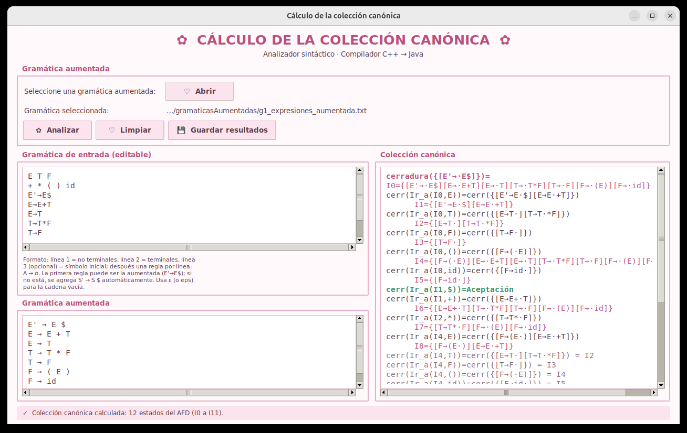
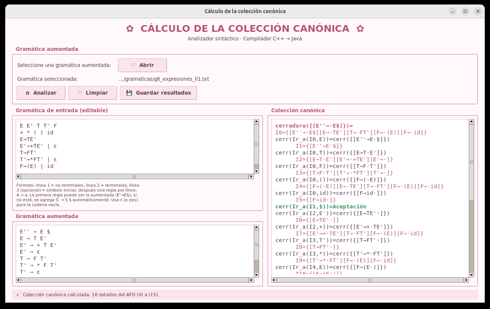

# Asignación 4 — Analizador sintáctico: Implementación del algoritmo de la colección canónica

Segunda entrega de la fase sintáctica del compilador **C++ → Java**: el cálculo
de la **colección canónica de elementos LR(0)** de una gramática aumentada. Es
decir, los estados `I0, I1, …` del AFD que reconoce los prefijos viables, a
partir de las funciones **cerradura** e **Ir_a**. Con estos estados se
construyen después las tablas del analizador sintáctico LR.

El programa lee una gramática desde un archivo de texto (o escrita en la propia
ventana) y muestra:

- **Gramática aumentada**: la gramática con la producción `S' → S $` al inicio.
- **Colección canónica**: cada paso `cerr(Ir_a(Ii, X))`, los estados nuevos
  con sus elementos, los estados repetidos (`= Ij`) y la aceptación.

Los resultados se pueden guardar en un archivo `.txt`. La interfaz es la misma
de la Asignación 3, organizada por capas, con la opción
*Analizadores → Analizador sintáctico → Algoritmo Colección Canónica*
agregada. Primeros y Siguientes y los analizadores léxicos siguen disponibles.



---

## Contenido de la carpeta

```
Implementación analizador sintáctico Implementacion del algoritmo de la colección canónica/
├── gramaticasAumentadas/    Gramáticas 1 a 6 ya aumentadas (S' → S $)
├── gramaticas/              Gramáticas 1 a 6 sin aumentar (Asignación 3)
├── src/compi/               Código fuente, organizado por capas
│   ├── persistencia/                       Capa de persistencia (lógica)
│   │   ├── analizadorSintacticoLR/
│   │   │   ├── ccanonica/coleccion_canonica.py      ColeccionCanonica: aumentar, cerradura, Ir_a
│   │   │   ├── generales/gramatica.py               Gramatica y LectorGramatica
│   │   │   └── primerosYsiguientes/                 PrimerosSiguientes (Asignación 3)
│   │   └── analizadorLexico/               Analizadores léxicos de las Asignaciones 1 y 2
│   └── presentacion/                       Capa de presentación (interfaz)
│       ├── compilador.py                   Compilador: punto de entrada (main)
│       ├── ventana_principal.py            VentanaPrincipal: menús, logo y cambio de pantalla
│       ├── asintactico/
│       │   ├── ventana_coleccion_canonica.py    Ventana del cálculo de la colección canónica
│       │   └── ventana_primeros_siguientes.py   Ventana de primeros y siguientes
│       └── alexico/                        Pantallas del analizador léxico (AFD y Flex)
├── archivos_prueba/         Programas C++ de ejemplo para los analizadores léxicos
├── documentacion/           Documentos de la asignación
│   ├── informe_coleccion_canonica.pdf     Informe: algoritmos, implementación y pruebas
│   ├── asignacion_actividades.pdf         Reparto de actividades del equipo
│   └── bitacora_actividades.pdf           Bitácora de actividades
├── flex/                    lexer.l del analizador léxico en Flex (Asignación 2)
├── herramientas/            win_flex y TinyCC para Windows (ver LEEME.txt)
├── imagenes/                Logo de la UTM para la pantalla de inicio
├── capturas/                Imágenes de la interfaz usadas en este README
├── iniciar.bat              Lanzador para Windows
├── iniciar.sh               Lanzador para Linux y macOS
└── iniciar.command          Lanzador para macOS (doble clic)
```

---

## Cómo ejecutarlo

Se necesita **Python 3.9 o superior con Tkinter**; no hay que instalar ninguna
biblioteca adicional. La colección canónica no necesita Flex; solo el analizador
léxico en Flex de la Asignación 2 pide `flex` y `gcc` en Linux y macOS.

- **Windows / macOS:** el instalador de [python.org](https://www.python.org/downloads/)
  ya incluye Tkinter. En Windows marca *Add python.exe to PATH*.
- **Linux:** `sudo apt install python3 python3-tk` (Ubuntu/Debian) o
  `sudo dnf install python3 python3-tkinter` (Fedora).

| Sistema | Cómo abrirlo |
|---------|--------------|
| Windows | doble clic en `iniciar.bat` |
| macOS   | doble clic en `iniciar.command` (la primera vez: clic derecho → *Abrir*) |
| Linux   | `sh iniciar.sh` |

O directamente desde la carpeta `src`:

```bash
cd src
python3 -m compi.presentacion.compilador
```

### Generar el ejecutable de Windows

Esta entrega no incluye `.exe`. Para generarlo, instala PyInstaller
(`pip install pyinstaller`) y, en Windows, ejecuta desde esta carpeta:

```bat
pyinstaller --onefile --windowed --name ColeccionCanonica --paths src ^
    --add-data "flex;flex" --add-data "imagenes;imagenes" ^
    --add-data "herramientas;herramientas" --add-data "gramaticas;gramaticas" ^
    --add-data "gramaticasAumentadas;gramaticasAumentadas" ^
    src/compi/presentacion/compilador.py
```

El ejecutable queda en `dist/ColeccionCanonica.exe`.

---

## Cómo se usa

1. En el menú **Analizadores → Analizador sintáctico**, elige
   **Algoritmo Colección Canónica**. Se abre una ventana hija de la ventana
   principal; mientras está abierta, la ventana principal no se puede usar.
2. Presiona **Abrir** y elige una gramática de `gramaticasAumentadas/` (también
   sirven las de `gramaticas/`), o escríbela en el panel de la izquierda.
3. Presiona **Analizar**. Abajo a la izquierda aparece la gramática aumentada y
   a la derecha la colección canónica. Los estados nuevos, los estados que ya
   existían y la aceptación se muestran en colores distintos.
4. **Guardar resultados** escribe la colección canónica en un archivo `.txt`.
5. **Limpiar** borra la gramática y los resultados.

Si la gramática no viene aumentada, el programa agrega `S' → S $`
automáticamente. Si `S'` ya existe, como `E'` en la gramática 6, usa `S''`.



---

## Formato del archivo de la gramática

Es el mismo de la Asignación 3. La primera regla puede ser la producción
aumentada, y no hace falta declarar `E'` ni `$` en el encabezado:

```
E T F          ← línea 1: no terminales
+ * ( ) id     ← línea 2: terminales
E'→E$          ← regla aumentada (opcional)
E→E+T          ← después, una regla de producción por línea
E→T
T→T*F
T→F
F→(E)
F→id
```

- La flecha puede escribirse `→`, `->` o `::=`.
- La cadena vacía se escribe `ε`, `eps`, `epsilon` o `λ`.
- Se permiten alternativas con `|` (`F→(E) | id`).

### Gramáticas incluidas

| Archivo en `gramaticasAumentadas/` | Gramática | Estados |
|------------------------------------|-----------|:-------:|
| `g1_expresiones_aumentada.txt` | Expresiones aritméticas con recursión por la izquierda | 12 |
| `g2_declaraciones_aumentada.txt` | Declaraciones de variables | 12 |
| `g3_declaraciones_aumentada.txt` | Declaraciones de variables con tipo opcional (ε) | 12 |
| `g4_sentencias_aumentada.txt` | Sentencias: asignación, `print` y secuencias | 23 |
| `g5_arreglos_aumentada.txt` | Declaración de arreglos | 14 |
| `g6_expresiones_ll1_aumentada.txt` | Expresiones aritméticas sin recursión por la izquierda | 16 |

Salida de la gramática 1 (inicio):

```
cerradura({[E'→·E$]})=
I0={[E'→·E$][E→·E+T][E→·T][T→·T*F][T→·F][F→·(E)][F→·id]}
cerr(Ir_a(I0,E))=cerr({[E'→E·$][E→E·+T]})
      I1={[E'→E·$][E→E·+T]}
cerr(Ir_a(I0,T))=cerr({[E→T·][T→T·*F]})
      I2={[E→T·][T→T·*F]}
...
cerr(Ir_a(I1,$))=Aceptación
...
cerr(Ir_a(I4,T))=cerr({[E→T·][T→T·*F]}) = I2
```

---

## Algoritmo

Un elemento `[A → α·β]` es una producción con un punto que indica cuánto de
ella ya se ha reconocido.

**cerradura(I)**: para cada elemento `[A → α·Bβ]` de `I` con `B` no terminal,
se agrega `[B → ·γ]` por cada producción `B → γ`. Esto se repite hasta que no
haya elementos nuevos.

**Ir_a(I, X)**: se avanza el punto sobre `X` en los elementos `[A → α·Xβ]` de
`I` y se calcula la cerradura del resultado.

**Colección canónica**:

```
C := { I0 := cerradura({[S' → ·S $]}) }
hacer
    para cada conjunto de elementos Ii en C
        para cada símbolo X que aparece después del punto en Ii
            si X es $, Ir_a(Ii, X) := aceptación
            si no, si Ir_a(Ii, X) no está vacío y no está en C,
                se agrega a C como un nuevo estado
mientras se agreguen conjuntos nuevos a C
```
