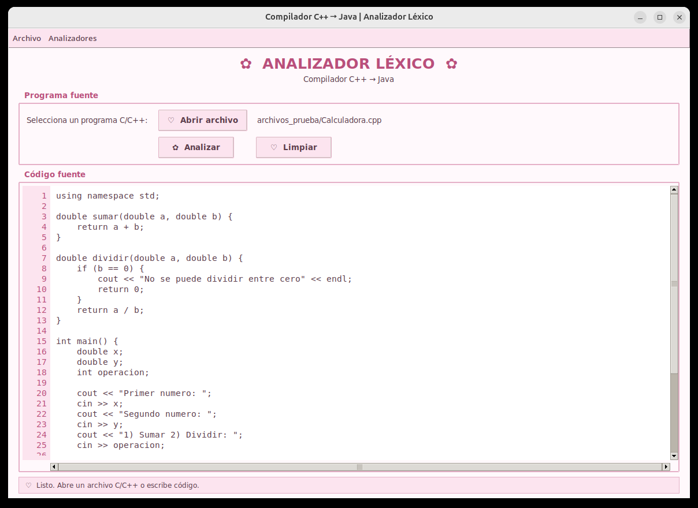
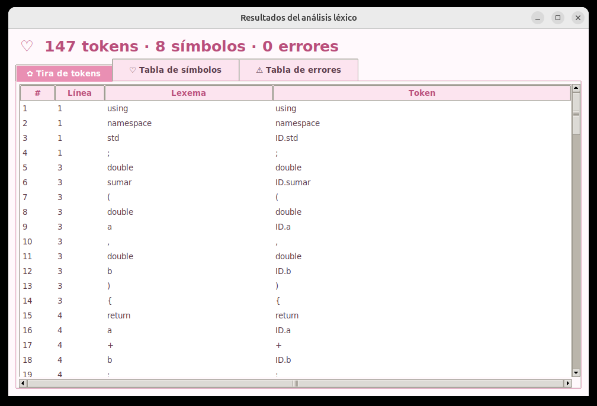
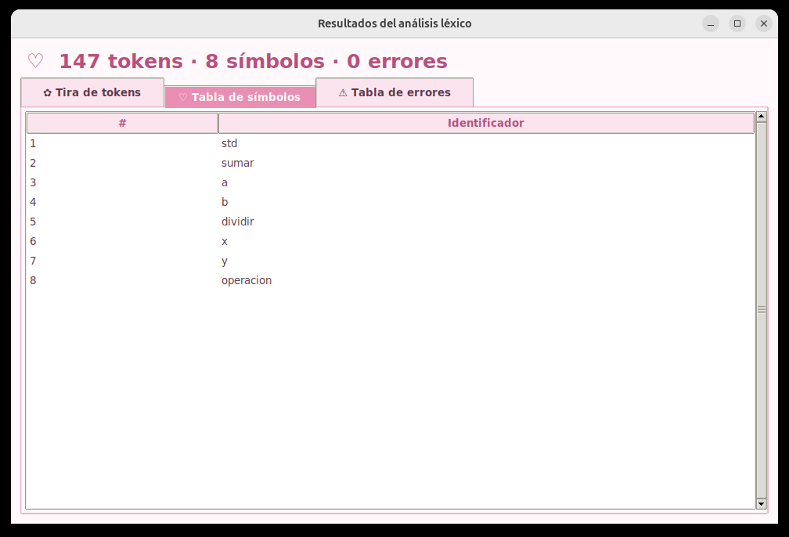
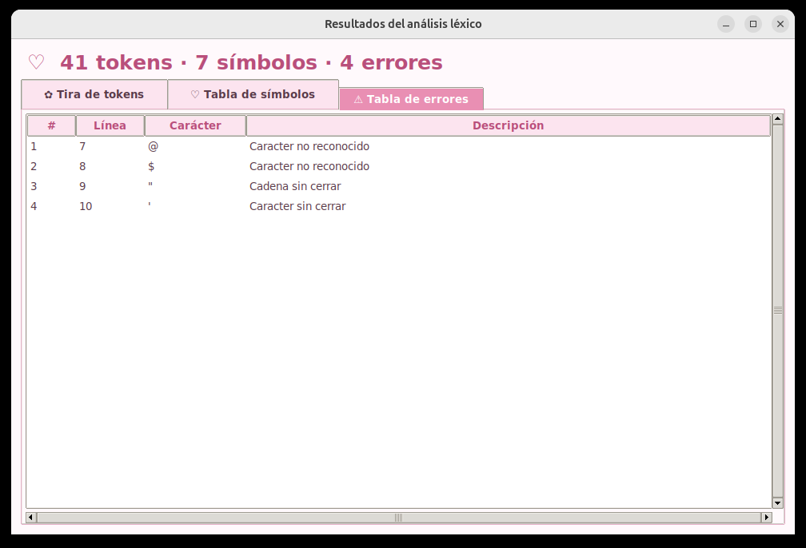

# Asignación 1 — Implementación de analizador lexico usando un AFD

Primera fase del compilador **C++ → Java**: un analizador léxico basado en un
**autómata finito determinista (AFD)**, con interfaz gráfica en Python/Tkinter.

Lee un programa fuente en C/C++ y produce las tres salidas del análisis léxico:

- **Tira de tokens**: cada componente léxico con su línea, lexema y token.
- **Tabla de símbolos**: los identificadores encontrados.
- **Tabla de errores**: los errores léxicos, con línea, columna, carácter y descripción.



---

## Contenido de la carpeta

```
Implementación de analizador lexico usando un AFD/
├── src/                     Código fuente de la interfaz y del analizador
│   ├── interfaz.py          Punto de entrada de la interfaz gráfica
│   ├── modulos/             Lógica del analizador léxico
│   │   ├── tokens.py              TokenLexico, ErrorLexico y PALABRAS_RESERVADAS
│   │   ├── lector_archivo.py      LectorArchivo: carga el programa fuente
│   │   ├── afd_lexico.py          AFDAlexico: estados y transiciones del autómata
│   │   ├── analizador_lexico.py   AnalizadorLexico: recorre el fuente con el AFD
│   │   └── main.py                Versión de línea de comandos
│   └── ui/                  Componentes de la interfaz gráfica
│       ├── estilos.py             Paleta de colores y estilos
│       ├── editor_codigo.py       Editor del código fuente con números de línea
│       ├── ventana_resultados.py  Ventana con las tres pestañas de resultados
│       ├── tira_tokens.py         Pestaña: tira de tokens
│       ├── tabla_simbolos.py      Pestaña: tabla de símbolos
│       ├── tabla_errores.py       Pestaña: tabla de errores
│       └── tabla_base.py          Tabla con barras de desplazamiento (base común)
├── archivos_prueba/         Programas C++ de ejemplo para analizar
├── automata/                Diseño del AFD
│   ├── AFD.jff                    Autómata en JFLAP (se abre con JFLAP)
│   └── AFD.png                    Imagen del autómata
├── documentacion/           Documentos de la asignación
│   ├── enunciado_asignacion1.pdf          Enunciado del profesor
│   ├── expresiones_regulares.pdf          Alfabeto y expresiones regulares del lenguaje
│   ├── DiagramaUML.pdf                    Diagrama de clases
│   ├── instrucciones_analizador_lexico.pdf Guía rápida de instalación y uso
│   ├── asignacion_actividades.pdf         Reparto de actividades del equipo
│   └── bitacora_actividades.pdf           Bitácora de actividades
├── ejecutable/
│   └── AnalizadorLexico.exe       Versión para Windows (no requiere instalar nada)
├── capturas/                Imágenes de la interfaz usadas en este README
├── iniciar.bat              Lanzador para Windows
├── iniciar.sh               Lanzador para Linux y macOS
└── iniciar.command          Lanzador para macOS (doble clic)
```

---

## Cómo ejecutarlo

### Opción 1: ejecutable de Windows (sin instalar nada)

1. Descarga `ejecutable/AnalizadorLexico.exe`.
2. Haz doble clic. La primera vez tarda unos segundos en abrir.
3. Si aparece **"Windows protegió su PC"**, presiona *Más información → Ejecutar
   de todas formas*. El aviso sale porque el programa no tiene firma digital.

### Opción 2: desde el código fuente (Windows, Linux y macOS)

Se necesita **Python 3.9 o superior con Tkinter**; no hay que instalar ninguna
biblioteca adicional.

- **Windows / macOS:** el instalador de [python.org](https://www.python.org/downloads/)
  ya incluye Tkinter. En Windows marca *Add python.exe to PATH*.
- **Linux:** `sudo apt install python3 python3-tk` (Ubuntu/Debian) o
  `sudo dnf install python3 python3-tkinter` (Fedora).

| Sistema | Cómo abrirlo |
|---------|--------------|
| Windows | doble clic en `iniciar.bat` |
| macOS   | doble clic en `iniciar.command` (la primera vez: clic derecho → *Abrir*) |
| Linux   | `sh iniciar.sh` |

O directamente desde esta carpeta:

```bash
python3 src/interfaz.py
```

### Opción 3: línea de comandos

```bash
cd src/modulos
python3 main.py ../../archivos_prueba/Fibonacci.cpp
```

Sin argumentos, analiza `archivos_prueba/prueba.cpp`.

---

## Cómo se usa

1. Presiona **Abrir archivo** y elige un programa de `archivos_prueba/`, o escribe
   o pega código directamente en el editor.
2. Presiona **Analizar**. Se abre una ventana con tres pestañas: tira de tokens,
   tabla de símbolos y tabla de errores.
3. Para ver errores léxicos, prueba con `ErroresLexicos.cpp`: reporta 4 errores.
4. **Limpiar** borra el código y cierra la ventana de resultados.

| Tira de tokens | Tabla de símbolos | Tabla de errores |
|:-:|:-:|:-:|
|  |  |  |

---

## Qué reconoce el analizador

El analizador lee el programa carácter por carácter y siempre toma el lexema más
largo que acepte el AFD. Descarta los espacios en blanco, los tabuladores y los
comentarios `//` y `/* */`.

**Identificadores y literales**

| Expresión regular | Token | Ejemplo |
|-------------------|-------|---------|
| `letra(letra\|_\|digito)*` | `IDENTIFICADOR` | `edad` |
| `digito+` | `NINT` | `42` |
| `digito+.digito+` | `NFLOAT` | `3.14` |
| `"..."` | `STRING` | `"Hola"` |
| `'.'` | `CARACTER` | `'a'` |

**Palabras reservadas** (`PALABRA_RESERVADA`, definidas en `src/modulos/tokens.py`)

`int` `float` `double` `char` `bool` `void` `string` `short` `long` `signed`
`unsigned` `if` `else` `switch` `case` `default` `while` `do` `for` `break`
`continue` `return` `true` `false` `main` `const` `static` `struct` `class`
`enum` `typedef` `public` `private` `protected` `new` `delete` `sizeof` `using`
`namespace` `cin` `cout` `endl`

**Operadores**

`+` `+=` `++` `-` `-=` `--` `->` `*` `*=` `**` `/` `/=` `%` `%=` `=` `==` `!`
`!=` `<` `<=` `<<` `>` `>=` `>>` `&` `&&` `|` `||` `?` `~` `^` `#` `\`

**Delimitadores**

`{` `}` `(` `)` `[` `]` `;` `,` `.` `:` `::`

### Errores léxicos

| Mensaje | Qué hace el analizador después |
|---------|------------------------------|
| `Caracter no reconocido` | Avanza un carácter y sigue |
| `Cadena sin cerrar` | Salta hasta el fin de la línea |
| `Caracter sin cerrar` | Salta hasta el fin de la línea |
| `Comentario de bloque sin cerrar` | Salta hasta el fin del archivo |
