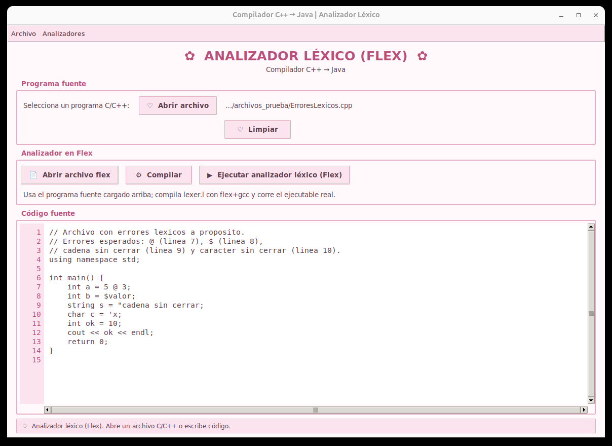
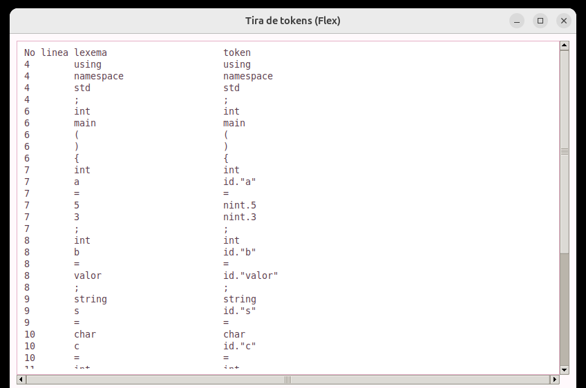
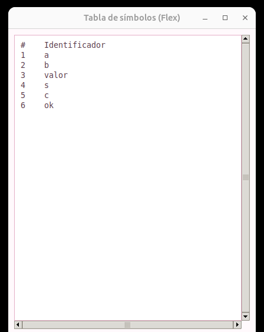
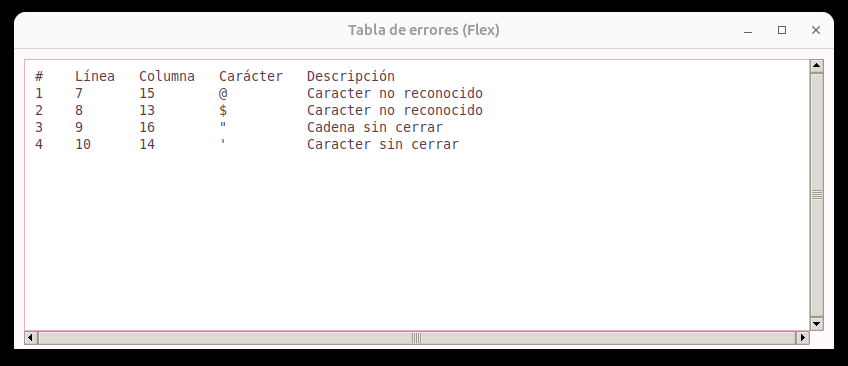
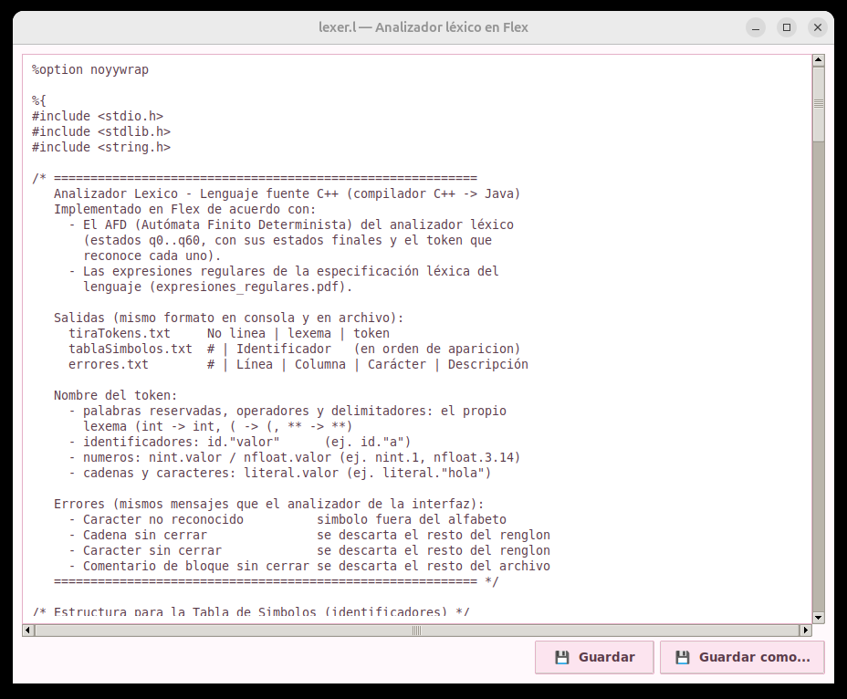

# Asignación 2 — Implementación del analizador léxico en Flex

Segunda entrega de la fase léxica del compilador **C++ → Java**: el mismo
analizador léxico de la Asignación 1, ahora escrito con **Flex**. En lugar de
programar el autómata a mano, las expresiones regulares de cada token se
escriben en `lexer.l`; Flex genera el analizador en C (`lex.yy.c`) y `gcc` lo
compila.

El programa produce las mismas tres salidas, con el mismo formato y los mismos
mensajes de error que la versión con AFD:

- **Tira de tokens** (`tiraTokens.txt`): línea, lexema y token.
- **Tabla de símbolos** (`tablaSimbolos.txt`): los identificadores en orden de aparición.
- **Tabla de errores** (`errores.txt`): línea, columna, carácter y descripción.

La interfaz gráfica, en Python/Tkinter, quedó organizada **por capas**
(persistencia y presentación) y permite elegir entre el analizador con AFD y el
analizador en Flex desde el menú *Analizadores → Analizador léxico*.



---

## Contenido de la carpeta

```
Implementación del analizador léxico en Flex/
├── flex/
│   └── lexer.l              Analizador léxico en Flex (aquí se generan lex.yy.c y los .txt)
├── src/compi/               Código fuente de la interfaz, organizado por capas
│   ├── __init__.py                RAIZ_PROYECTO: ubica flex/, imagenes/ y herramientas/
│   ├── persistencia/analizadorLexico/      Capa de persistencia (lógica)
│   │   ├── flex/compilador_flex.py         Compila lexer.l con flex + gcc y ejecuta el analizador
│   │   ├── alexico/afd_lexico.py           AFDAlexico: el AFD de la Asignación 1
│   │   ├── alexico/analizador_lexico.py    AnalizadorLexico: recorre el fuente con el AFD
│   │   └── generales/                      tokens.py y lector_archivo.py
│   └── presentacion/                       Capa de presentación (interfaz)
│       ├── compilador.py                   Compilador: punto de entrada (main)
│       ├── ventana_principal.py            VentanaPrincipal: menús, logo y cambio de pantalla
│       └── alexico/
│           ├── ventana_alexico_flex.py     Pantalla del analizador en Flex
│           ├── ventana_alexico.py          Pantalla del analizador con AFD
│           ├── pantalla_analizador.py      Base común de las dos pantallas
│           ├── ventana_texto.py            Ventana de texto (lexer.l y resultados de Flex)
│           ├── ventana_resultados.py       Pestañas de resultados del AFD
│           ├── tira_tokens.py, tabla_simbolos.py, tabla_errores.py, tabla_base.py
│           └── editor_codigo.py, estilos.py
├── archivos_prueba/         Programas C++ de ejemplo para analizar
├── documentacion/           Documentos de la asignación
│   ├── informe_analizador_flex.pdf        Informe: análisis, lexer.l, compilación y pruebas
│   ├── asignacion_actividades.pdf         Reparto de actividades del equipo
│   └── bitacora_actividades.pdf           Bitácora de actividades
├── ejecutable/
│   └── AnalizadorLexicoFlex.exe   Versión para Windows (trae flex y compilador de C)
├── herramientas/            win_flex y TinyCC para Windows (ver LEEME.txt)
├── imagenes/                Logo de la UTM para la pantalla de inicio
├── capturas/                Imágenes de la interfaz usadas en este README
├── iniciar.bat              Lanzador para Windows
├── iniciar.sh               Lanzador para Linux y macOS
└── iniciar.command          Lanzador para macOS (doble clic)
```

---

## Cómo ejecutarlo

### Opción 1: ejecutable de Windows (sin instalar nada)

1. Descarga `ejecutable/AnalizadorLexicoFlex.exe`.
2. Haz doble clic. La primera vez tarda unos segundos en abrir.
3. Si aparece **"Windows protegió su PC"**, presiona *Más información → Ejecutar
   de todas formas*. El aviso sale porque el programa no tiene firma digital.

El `.exe` ya incluye Flex (win_flex) y un compilador de C (TinyCC). Al usarlo
crea una carpeta `flex/` junto al ejecutable, donde quedan `lexer.l`, el
analizador compilado y los archivos `.txt` de salida.

### Opción 2: desde el código fuente (Windows, Linux y macOS)

Se necesita **Python 3.9 o superior con Tkinter**. Para el analizador en Flex
también hacen falta **flex** y **gcc**; en Windows no, porque se usan los de
`herramientas/`.

- **Windows / macOS:** el instalador de [python.org](https://www.python.org/downloads/)
  ya incluye Tkinter. En Windows marca *Add python.exe to PATH*. En macOS,
  `xcode-select --install` instala flex y el compilador de C.
- **Linux:** `sudo apt install python3 python3-tk flex gcc` (Ubuntu/Debian) o
  `sudo dnf install python3 python3-tkinter flex gcc` (Fedora).

| Sistema | Cómo abrirlo |
|---------|--------------|
| Windows | doble clic en `iniciar.bat` |
| macOS   | doble clic en `iniciar.command` (la primera vez: clic derecho → *Abrir*) |
| Linux   | `sh iniciar.sh` |

O directamente desde la carpeta `src`:

```bash
cd src
python3 -m compi.presentacion.compilador
```

### Opción 3: Flex desde la terminal (sin interfaz)

```bash
cd flex
flex lexer.l
gcc -o analizador_lexico lex.yy.c
./analizador_lexico ../archivos_prueba/Fibonacci.cpp
```

La tira de tokens y la tabla de símbolos se imprimen en la consola, los errores
en la salida de error, y las tres tablas quedan en `tiraTokens.txt`,
`tablaSimbolos.txt` y `errores.txt`. Sin argumentos, analiza `prueba.cpp` de la
carpeta actual.

---

## Cómo se usa

1. En el menú **Analizadores → Analizador léxico**, elige
   **Analizador léxico_Flex**.
2. Presiona **Abrir archivo** y elige un programa de `archivos_prueba/`, o escribe
   o pega código directamente en el editor.
3. **Abrir archivo flex** muestra `lexer.l` en una ventana donde se puede editar
   y guardar.
4. **Compilar** ejecuta `flex lexer.l` y `gcc lex.yy.c`.
5. **Ejecutar analizador léxico (Flex)** corre el analizador sobre el programa
   cargado y abre tres ventanas: tira de tokens, tabla de símbolos y tabla de
   errores. Cada una se puede guardar con *Guardar como…*.
6. Para ver errores léxicos, prueba con `ErroresLexicos.cpp`: reporta 4 errores.

El analizador con AFD de la Asignación 1 sigue disponible en
**Analizador léxico_AFD**, para comparar los resultados de ambos.

| Tira de tokens | Tabla de símbolos | Tabla de errores |
|:-:|:-:|:-:|
|  |  |  |



---

## Qué reconoce el analizador

Flex siempre toma la coincidencia más larga (por ejemplo, `++` antes que `+`) y,
si dos reglas reconocen lo mismo, la que aparece primero en `lexer.l`; por eso
las palabras reservadas van antes que los identificadores. Se descartan los
espacios en blanco, los tabuladores y los comentarios `//` y `/* */`.

**Identificadores y literales**

| Expresión regular en Flex | Token | Ejemplo |
|---------------------------|-------|---------|
| `{letra}({letra}\|{digito}\|_)*` | `id."valor"` | `edad` → `id."edad"` |
| `{digito}+` | `nint.valor` | `42` → `nint.42` |
| `{digito}+\.{digito}+` | `nfloat.valor` | `3.14` → `nfloat.3.14` |
| `\"({caracterCadena}\|{escape})*\"` | `literal.valor` | `"Hola"` → `literal."Hola"` |
| `'[^'\n]'` | `literal.valor` | `'a'` → `literal.'a'` |

**Palabras reservadas** (el token es la propia palabra)

`int` `float` `double` `char` `bool` `void` `string` `short` `long` `signed`
`unsigned` `if` `else` `switch` `case` `default` `while` `do` `for` `break`
`continue` `return` `true` `false` `main` `const` `static` `struct` `class`
`enum` `typedef` `public` `private` `protected` `new` `delete` `sizeof` `using`
`namespace` `cin` `cout` `endl` `std` `printf` `scanf`

**Operadores** (el token es el propio operador)

`+` `+=` `++` `-` `-=` `--` `->` `*` `*=` `**` `/` `/=` `%` `%=` `=` `==` `!`
`!=` `<` `<=` `<<` `>` `>=` `>>` `&` `&&` `|` `||` `?` `~` `^` `.` `::`

**Delimitadores**

`{` `}` `(` `)` `[` `]` `;` `,` `:` `#`

### Errores léxicos

| Mensaje | Qué hace el analizador después |
|---------|------------------------------|
| `Caracter no reconocido` | Avanza un carácter y sigue |
| `Cadena sin cerrar` | Descarta el resto de la línea |
| `Caracter sin cerrar` | Descarta el resto de la línea |
| `Comentario de bloque sin cerrar` | Descarta el resto del archivo |
